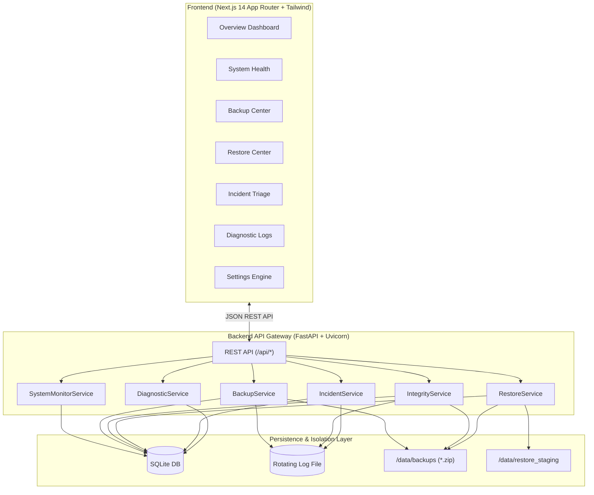

# RecoverX — Linux & Infrastructure System Monitoring, Backup & Recovery Platform

[](https://python.org)
[](https://fastapi.tiangolo.com)
[](https://nextjs.org)
[](https://www.typescriptlang.org)
[](https://tailwindcss.com)
[](https://docs.pytest.org)

**RecoverX** is an enterprise-grade local infrastructure observability, automated backup management, and disaster recovery platform built for Site Reliability Engineers (SREs), systems administrators, and cybersecurity professionals to monitor system telemetry, verify cryptographic SHA-256 backup manifests, and safely execute atomic file restorations.

> [!NOTE]
> **Educational Prototype Notice**: RecoverX is designed as a secure, local-first platform for hands-on learning and demonstrating core enterprise disaster recovery and technical support concepts.

---

## 1. Key Features

- 📊 **Real-Time Hardware Observability**: Continuous telemetry collection using `psutil` (CPU logical/physical cores, RAM utilization, partition storage capacity, network IO throughput, and uptime).
- 📦 **Verifiable Backup Engine**: Create secure ZIP backup archives with embedded `manifest.json` recording relative file paths, byte sizes, and individual SHA-256 hashes.
- 🛡️ **Cryptographic SHA-256 Integrity Verification**: Detect bit-rot, tampering, and CRC failures by computing whole-archive and per-file cryptographic digests.
- 🔄 **Atomic Disaster Recovery**: Multi-step restore wizard featuring pre-flight conflict checks, isolated staging extraction, and post-restore verification reports.
- 🚨 **Automated Incident Triage**: Threshold-based incident detection engine with automated alert deduplication, actionable runbook SOPs, and resolution notes tracking.
- 🩺 **Allowlisted Diagnostic Suite**: On-demand system health check verifying storage permissions, SQLite B-tree integrity (`PRAGMA integrity_check`), and security root accessibility.
- 🔒 **Defensive Security Model**: Strict path traversal prevention, protected system directory blocklists, and sanitized archive entry extraction (Zip Slip mitigation).
- ⚙️ **Configurable Thresholds**: Customizable CPU/RAM/Disk alert triggers, polling intervals, and historical time-series retention windows.

---

## 2. Architecture & Data Flow



---

## 3. Technology Stack

- **Frontend**: Next.js 14 (App Router), React 18, TypeScript, Tailwind CSS, Recharts, Lucide Icons, clsx, tailwind-merge.
- **Backend**: Python 3.11+, FastAPI, Uvicorn, Pydantic V2, `pydantic-settings`, SQLAlchemy 2.0, `psutil`, `httpx`, `pytest`.
- **Security & Storage**: Cryptographic `hashlib` SHA-256, SQLite 3, Python `logging` with `RotatingFileHandler`.
- **Containerization**: Docker, Docker Compose.

---

## 4. Repository Monorepo Structure

```
RecoverX/
├── backend/
│   ├── app/
│   │   ├── main.py                  # Application entry & background collector
│   │   ├── core/                    # Config, database, & rotating logging
│   │   ├── models/                  # SQLAlchemy models (Metric, Backup, Incident, etc.)
│   │   ├── schemas/                 # Pydantic validation schemas
│   │   ├── api/routes/              # REST endpoint routes
│   │   ├── services/                # Monitoring, backup, integrity, restore, & incident services
│   │   └── utils/                   # Path validator & SHA-256 hashing
│   ├── tests/                       # Pytest test suite (15 automated test cases)
│   ├── requirements.txt             # Pinned backend dependencies
│   └── Dockerfile                   # Python container image
├── frontend/
│   ├── src/
│   │   ├── app/                     # Next.js App Router pages (Overview, Backups, etc.)
│   │   ├── components/              # Sidebar, Header, Modals, Badges, Charts
│   │   └── lib/                     # API client, TypeScript types, utilities
│   ├── package.json                 # Frontend dependencies
│   ├── tailwind.config.ts           # Enterprise dark theme tokens
│   └── Dockerfile                   # Next.js standalone container image
├── sample_data/                     # Disposable sample configs, SQL dumps, & logs
├── scripts/
│   ├── start-dev.bat                # Windows local startup script
│   ├── start-dev.sh                 # Linux / WSL2 startup script
│   ├── run-tests.bat                # Monorepo test runner
│   └── setup-sample-files.py        # Disposable sample generator
├── docs/
│   ├── ARCHITECTURE.md              # Detailed architecture specification
│   ├── THREAT_MODEL.md              # Threat vectors & security controls
│   ├── TROUBLESHOOTING.md           # Troubleshooting guide
│   └── TEST_PLAN.md                 # QA test matrix
├── docker-compose.yml               # Multi-container orchestration
├── .env.example                     # Environment template
├── .gitignore
└── README.md
```

---

## 5. Getting Started & Setup

### Prerequisites
- **Python**: Version 3.11 or newer.
- **Node.js**: Version 18.x, 20.x, or 22.x with `npm`.
- **Docker** *(optional)*: Docker Engine 24+ and Docker Compose v2.

---

### Local Development Setup (Windows)

1. **Clone and enter repository**:
   ```cmd
   cd c:\PROJECTS\RECOVERX
   ```

2. **Set up Python Virtual Environment**:
   ```cmd
   python -m venv backend\venv
   backend\venv\Scripts\pip install -r backend\requirements.txt
   ```

3. **Install Frontend Dependencies**:
   ```cmd
   cd frontend
   npm install
   cd ..
   ```

4. **Generate Sample Data**:
   ```cmd
   backend\venv\Scripts\python scripts\setup-sample-files.py
   ```

5. **Start Both Services**:
   ```cmd
   scripts\start-dev.bat
   ```
   - **Frontend UI**: Open [http://localhost:3000](http://localhost:3000)
   - **Backend API & Swagger Docs**: Open [http://127.0.0.1:8000/docs](http://127.0.0.1:8000/docs)

---

### Local Development Setup (Linux / WSL2)

1. **Set up Virtual Environment**:
   ```bash
   python3 -m venv backend/venv
   source backend/venv/bin/activate
   pip install -r backend/requirements.txt
   ```

2. **Install Frontend Dependencies**:
   ```bash
   cd frontend && npm install && cd ..
   ```

3. **Generate Sample Data**:
   ```bash
   python3 scripts/setup-sample-files.py
   ```

4. **Start Both Services**:
   ```bash
   chmod +x scripts/start-dev.sh
   ./scripts/start-dev.sh
   ```

---

### Docker Compose Setup

Run the entire monorepo in containerized isolation with persistent volumes:
```bash
docker-compose up --build
```
- **Web UI**: [http://localhost:3000](http://localhost:3000)
- **API**: [http://localhost:8000/api/health](http://localhost:8000/api/health)

---

## 6. API Endpoint Reference

| Method | Endpoint | Description |
| :--- | :--- | :--- |
| `GET` | `/api/health` | Liveness & basic platform health check |
| `GET` | `/api/readyz` | Database connectivity readiness probe |
| `GET` | `/api/system/summary` | High-level CPU, RAM, Disk, and system status summary |
| `GET` | `/api/system/metrics` | Live point-in-time metric reading |
| `GET` | `/api/system/metrics/history` | Chronological metric readings for time-series charts |
| `GET` | `/api/system/disks` | Partition mountpoints and disk usage metrics |
| `GET` | `/api/system/network` | Network interface status and packet counters |
| `POST` | `/api/backups` | Create verifiable ZIP backup with SHA-256 manifest |
| `GET` | `/api/backups` | List all backup archives and verification states |
| `GET` | `/api/backups/{id}` | Inspect specific backup metadata and manifest |
| `POST` | `/api/backups/{id}/verify` | Execute cryptographic SHA-256 verification |
| `DELETE`| `/api/backups/{id}` | Permanently delete backup archive and DB record |
| `POST` | `/api/backups/{id}/restore/preview` | Preview restore file list & check existing file collisions |
| `POST` | `/api/backups/{id}/restore` | Execute atomic restore to designated target |
| `GET` | `/api/restores` | List historical restore operations and checksum reports |
| `GET` | `/api/incidents` | List detected operational incidents (with filtering) |
| `POST` | `/api/incidents/{id}/acknowledge` | Acknowledge active incident |
| `POST` | `/api/incidents/{id}/resolve` | Resolve incident with required remediation notes |
| `POST` | `/api/demo/simulate-incident` | Simulate incidents (CPU spike, bit-rot, OOM, disk full) |
| `GET` | `/api/logs` | Query structured diagnostic logs with search and filters |
| `POST` | `/api/diagnostics/run` | Execute allowlisted storage and DB health checks |
| `GET` | `/api/settings` | Retrieve active threshold configurations |
| `PUT` | `/api/settings` | Update and persist threshold settings |

---

## 7. Running Automated Tests

The test suite covers API health, telemetry, backup creation, bit-rot detection, path traversal defenses, zip slip sanitization, restore preview, and settings validation.

```bash
# Run backend pytest suite (Windows)
$env:PYTHONPATH="."; backend\venv\Scripts\pytest backend\tests -v

# Run frontend build check
cd frontend && npm run build
```

---

## 8. Disaster Recovery Workflow Walkthrough

1. **Generate Disposable Data**: Run `scripts/setup-sample-files.py` to create test data in `sample_data/`.
2. **Create Snapshot**: In **Backup Center**, click **Create New Backup** and select `sample_data/configs`.
3. **Verify SHA-256**: Click **Run SHA-256 Verification** on the created backup to confirm archive and file checksums match.
4. **Inspect Manifest**: Click **Inspect Manifest** to view the relative file list and individual SHA-256 cryptographic hashes.
5. **Simulate Disaster & Restore**:
   - Open **Restore Center**, select the backup snapshot.
   - Click **Preview Restore** to inspect target files and conflict warnings.
   - Click **Confirm & Execute Restore** to trigger staged, verified file extraction.
   - Review the post-restore verification report.

---

## 9. Security Design & Boundaries

- **Strict Path Validation**: All source and target paths are resolved against `settings.ALLOWED_ROOTS`.
- **Zip Slip Defense**: Archive entries are sanitized to reject drive letters, traversal components (`..`), and absolute root paths.
- **Loop Prevention**: Checks prevent backing up the backup repository directory into itself.
- **Fixed Diagnostic Allowlist**: Diagnostics execute native Python system checks without accepting or executing arbitrary user-supplied shell commands.

---

## 10. License

RecoverX is released under the **MIT License** for educational and demonstration purposes.
