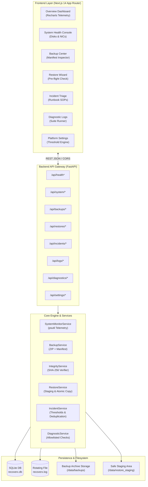

# RecoverX — System Architecture & Design Specification

## 1. System Overview

**RecoverX** is a local-first observability, automated backup management, and disaster recovery platform built for learning and demonstrating core Site Reliability Engineering (SRE), cybersecurity, and enterprise technical support concepts.

The platform continuously samples real hardware telemetry, validates directory and archive paths against strict security boundaries, computes cryptographic SHA-256 digests for individual files and entire archives, executes staged atomic file restorations, and provides deduplicated incident triage workflows.



---

## 2. Core Subsystems

### A. System Monitor & Telemetry Collector
- **Technology**: `psutil`, `platform`, Python `asyncio` background task.
- **Metrics Collected**:
  - Logical & physical CPU core counts, live utilization %.
  - RAM total, used, free MB, and percentage.
  - Disk partitions, device mountpoints, filesystem types, used/free GB.
  - Network interfaces, status UP/DOWN, transmitted/received MB, packet counters.
  - System boot time, uptime, and active process count.
- **Persistence & Retention**:
  - Background task executes every `POLLING_INTERVAL_SECONDS` (default: 5s).
  - Telemetry is recorded to SQLite `Metric` table.
  - Automatic retention pruning removes readings older than `METRICS_RETENTION_HOURS` (default: 48h).

### B. Backup Engine & Manifest Generator
- **Archive Format**: Standard ZIP format (`zipfile` with `ZIP_DEFLATED` compression).
- **Embedded Manifest (`manifest.json`)**:
  ```json
  {
    "backup_id": "bkp_20261009_120000_a1b2c3",
    "created_at": "2026-10-09T12:00:00+00:00",
    "source_label": "Configs Backup",
    "source_path": "C:\\PROJECTS\\RECOVERX\\sample_data\\configs",
    "file_count": 2,
    "total_uncompressed_bytes": 1024,
    "files": [
      {
        "rel_path": "nginx.conf",
        "size_bytes": 512,
        "sha256": "4a2f8b...",
        "modified_time": "2026-10-09T10:00:00+00:00"
      }
    ]
  }
  ```
- **Checksum Calculation**:
  - Computes SHA-256 for each included file in streaming chunks (64 KB).
  - Computes overall archive file SHA-256 digest upon ZIP closure.
  - Records metadata in SQLite `Backup` table.

### C. Cryptographic Integrity Verification
- **Verification Pipeline**:
  1. Opens archive and verifies ZIP structure and CRC checks (`testzip()`).
  2. Computes whole-archive SHA-256 hash and validates against DB checksum.
  3. Extracts embedded `manifest.json` in memory.
  4. Iterates through manifest file entries and compares calculated byte SHA-256 against recorded hashes.
  5. Updates verification status to `VERIFIED` or `CORRUPTED`.
  6. Automatically raises a critical incident upon detecting bit-rot or file alteration.

### D. Safe Disaster Recovery & Restoration
- **Pre-flight Conflict Detection**: Checks target destination for existing filename collisions without altering disk state.
- **Staging & Isolation**:
  - Extracts payload exclusively into a temporary staging folder (`data/restore_staging/stage_<restore_id>`).
  - Verifies extracted files against manifest hashes before copying to destination.
  - Enforces overwrite confirmation policy.
  - Cleans up staging directory post-execution.
  - Generates full post-restore checksum report recorded in SQLite `Restore` table.

### E. Incident Detection & Deduplication Engine
- **Threshold Rule Evaluation**:
  - CPU Warning / Critical.
  - Memory Warning / Critical.
  - Storage Warning / Critical.
  - Backup Creation Failures.
  - Integrity Verification Mismatches.
  - Restore Execution Failures.
- **Deduplication**: Recurring triggers within active state update `last_observed_at` and evidence without generating duplicate alert noise.
- **Lifecycle**: `OPEN` -> `ACKNOWLEDGED` -> `RESOLVED` (with mandatory resolution notes).

---

## 3. Database Schema

| Table | Primary Key | Key Columns | Purpose |
| :--- | :--- | :--- | :--- |
| `metrics` | `id` (int autoincrement) | `timestamp`, `cpu_percent`, `memory_percent`, `disk_percent`, `network_sent_mb` | Historical telemetry time-series |
| `backups` | `id` (string 64) | `label`, `created_at`, `archive_path`, `sha256_checksum`, `verification_status`, `manifest_json` | Backup archive metadata & manifests |
| `restores` | `id` (string 64) | `backup_id`, `created_at`, `destination_path`, `status`, `sha256_report_json` | Disaster recovery audit log |
| `incidents` | `id` (string 64) | `title`, `severity`, `category`, `status`, `first_detected_at`, `troubleshooting_steps` | Operational alerts & triage |
| `diagnostic_logs` | `id` (int autoincrement) | `timestamp`, `severity`, `component`, `event_type`, `message`, `related_id` | Structured application & system audit logs |
| `app_settings` | `key` (string 128) | `value` (JSON text), `updated_at` | Persisted configuration overrides |
